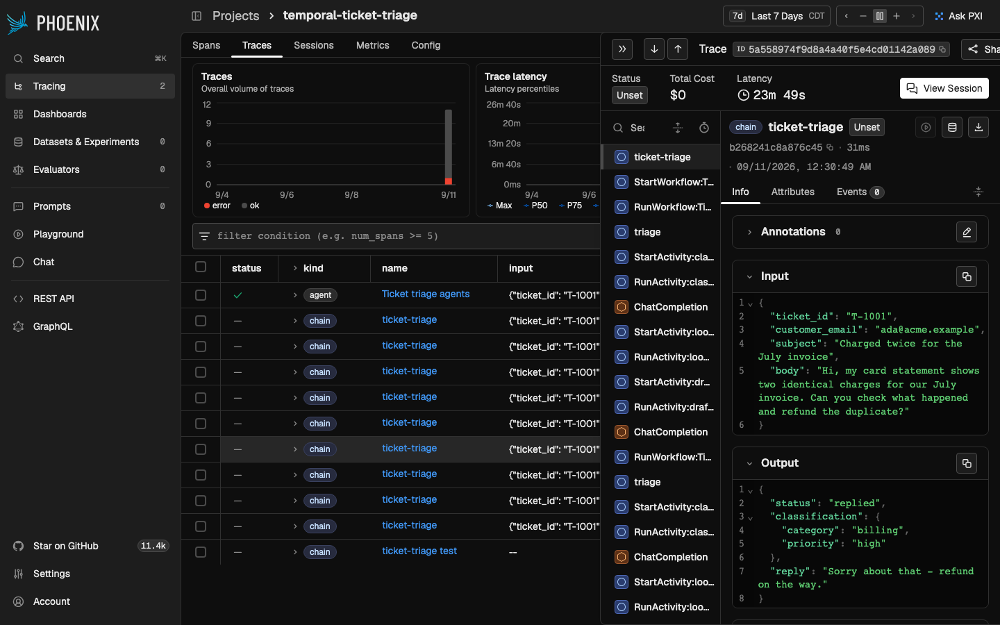
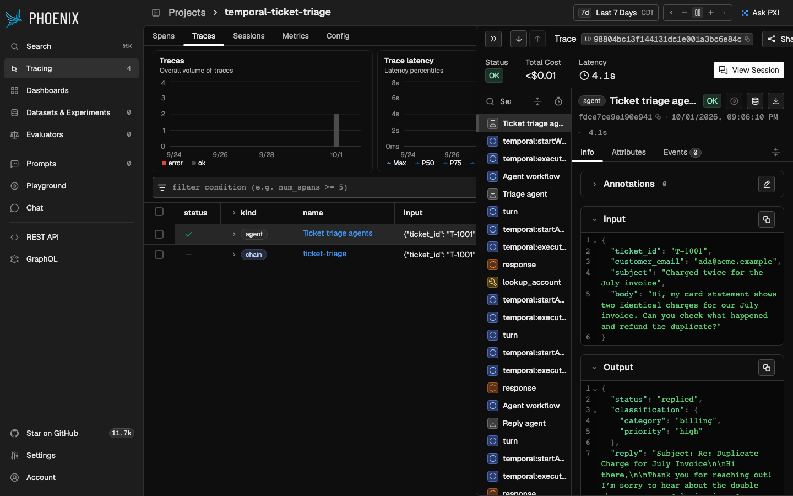
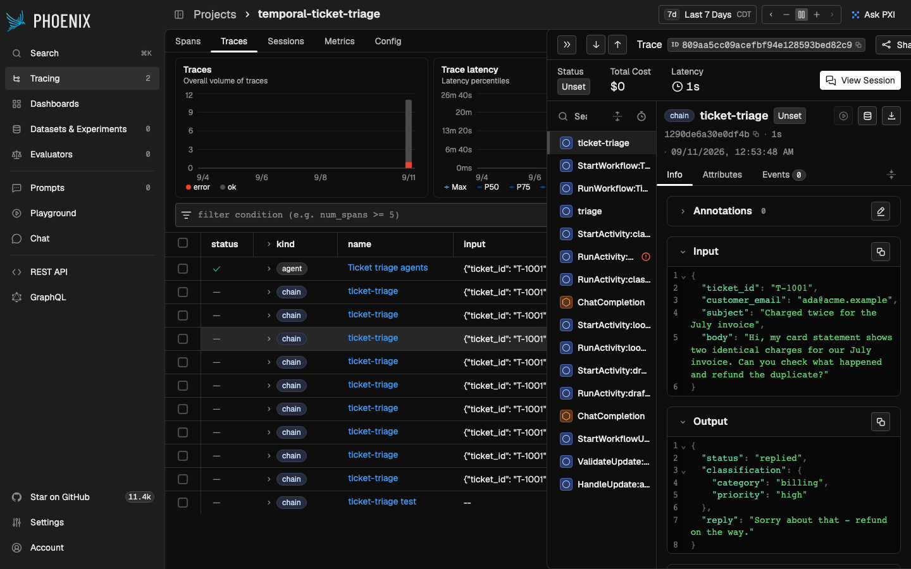

# Arize Tracing

Send Temporal workflow traces to [Arize Phoenix](https://arize.com/docs/phoenix)
(open source) or [Arize AX](https://arize.com/docs/ax) with Temporal's
[`OpenTelemetryPlugin`](https://python.temporal.io/temporalio.contrib.opentelemetry.OpenTelemetryPlugin.html),
a standard OTLP/HTTP exporter, and the
[OpenInference](https://github.com/Arize-ai/openinference) conventions Arize
renders. No Arize SDK is involved, workflow code stays deterministic and
sandboxed, and traces come out correctly nested, typed, and duplicate-free
across replay and worker restarts.

- **[ticket_triage/](ticket_triage/)**: the framework-agnostic pattern. Two LLM
  activities, one plain activity, and a human approval delivered as a workflow
  update; LLM calls are captured by the OpenInference OpenAI instrumentation.
- **[ticket_triage_agents/](ticket_triage_agents/)**: the same flow on the
  [OpenAI Agents SDK](https://openai.github.io/openai-agents-python/) through
  `OpenAIAgentsPlugin(use_otel_instrumentation=True)`, so Arize shows native
  AGENT, LLM, and TOOL spans.
- **[telemetry.py](telemetry.py)**: the replay-safe tracer provider, the
  Phoenix/Arize AX exporter, and the OpenInference enrichment processor.
- **[verify_trace.py](verify_trace.py)**: checks a trace through the Phoenix
  REST API: tree shape with span kinds, enrichment attributes, LLM token
  usage, activity attempts, and that no span is missing its parent.

## Prerequisites

- Python 3.11 or newer, `uv`, Docker (for Phoenix) or `uvx`, and a local
  Temporal server (`temporal server start-dev`).
- An OpenAI API key, or any OpenAI-compatible endpoint via `OPENAI_BASE_URL`.

## Run it

The sample is its own uv project because `temporalio-openai-agents` needs
`openai` 3 while the repository's root lock stays on 2. Run everything from
this directory:

```bash
cd arize_tracing

# 1. Start Phoenix (UI, REST API, and OTLP collector on port 6006)
docker compose -f phoenix/docker-compose.yml up -d
#    ...or without Docker: uvx --from "arize-phoenix==20.16.0" phoenix serve

# 2. Install dependencies and set the environment
uv sync
cp .env.example .env   # edit the LLM settings
set -a; source .env; set +a

# 3. Run the sample (two terminals, same environment)
uv run python -m ticket_triage.worker
uv run python -m ticket_triage.starter     # add --decline to reject the ticket

# 4. Verify the trace through the Phoenix API
uv run verify_trace.py --trace-id <printed trace id>   # add --expect declined
```

The sample is self-contained: copy this directory, keep its `pyproject.toml`
(or merge its dependencies into yours), and run the same commands.

The starter prints a link to the trace in Phoenix (project
`temporal-ticket-triage`). It is shaped like this, with the OpenInference
kinds Arize renders:

```
ticket-triage                                    CHAIN  (root; session = workflow id, user, input, output, tags)
├─ StartWorkflow:TicketTriageWorkflow            CHAIN
│  └─ RunWorkflow:TicketTriageWorkflow           CHAIN
│     ├─ triage                                  CHAIN  (custom span from workflow code)
│     │  ├─ StartActivity:classify_ticket → RunActivity:classify_ticket   CHAIN, attempt 1
│     │  │  └─ ChatCompletion                    LLM    (model, tokens, messages)
│     │  └─ StartActivity:lookup_account  → RunActivity:lookup_account
│     └─ StartActivity:draft_reply → RunActivity:draft_reply
│        └─ ChatCompletion                       LLM
└─ StartWorkflowUpdate:approve                   CHAIN
   ├─ ValidateUpdate:approve                     CHAIN
   └─ HandleUpdate:approve                       CHAIN
```



The Sessions tab groups traces by workflow ID (`session.id`). Start the
starter with `--workflow-id <id>` more than once to see several traces in one
session.

### With the OpenAI Agents SDK

```bash
uv run python -m ticket_triage_agents.worker
uv run python -m ticket_triage_agents.starter
uv run verify_trace.py --trace-id <printed trace id> --scenario agents
```

Here the Agents SDK trace is the root AGENT span, and the plugin creates the
`temporal:*` CHAIN spans itself, so `OpenTelemetryPlugin` is not added as
well. `setup_tracing()` must run before the plugin is constructed, because the
plugin checks that the global tracer provider is Temporal's replay-safe one.
The plugin propagates trace context but not baggage, so `session.id` and
`user.id` live on the root span, which is enough for Phoenix's Sessions view.

```
Ticket triage agents                             AGENT  (root; session, user, input, output)
├─ temporal:startWorkflow:TicketTriageAgentsWorkflow   CHAIN
│  └─ temporal:executeWorkflow                   CHAIN
│     ├─ Agent workflow → Triage agent           AGENT
│     │  ├─ turn                                 CHAIN
│     │  │  ├─ temporal:startActivity → temporal:executeActivity → response   LLM  (model call)
│     │  │  └─ lookup_account                    TOOL   (a Temporal activity as an agent tool)
│     │  │     └─ temporal:startActivity → temporal:executeActivity
│     │  └─ turn → temporal:startActivity → temporal:executeActivity → response   LLM
│     └─ Agent workflow → Reply agent            AGENT
│        └─ turn → temporal:startActivity → temporal:executeActivity → response   LLM
└─ temporal:updateWorkflow                       CHAIN
```



## How replay, retries, and restarts show up

Workflow code re-executes (replays) on worker restarts and cache evictions,
and activities retry. The rule: **replay produces no spans, real
re-executions do**, which matches what the Temporal Web UI shows.

| What happened | Temporal Web UI | Arize |
|---|---|---|
| Workflow replayed (worker restart, cache eviction, `--replay-stress`) | Nothing: Event History is unchanged | Nothing: spans re-created during replay have the same deterministic IDs and are never exported again |
| Activity retried | Pending Activities shows attempt N and the last failure | One `RunActivity` span per attempt under one `StartActivity`, failed attempts with error status, `temporal.activity.attempt` = 1, 2, ... Arize AX lists the whole trace as an error when any attempt failed, even though the workflow completed |
| Worker died while the workflow waited | Workers tab / Workflow Task timeouts | The `RunWorkflow` span exports once, when the workflow finishes on another worker; its duration covers the outage |
| Worker died mid-activity | The attempt is not recorded; the next attempt is | The attempt's span was never ended, so it does not appear; the next attempt does |
| Workflow Task failed (bug, non-determinism) | `WorkflowTaskFailed` events | Spans that ended inside the failed task are exported again with the same span ID; Phoenix deduplicates by span ID and keeps one copy |
| Reset or retried workflow (new run) | New run under the same Workflow Id | Another `RunWorkflow` span with its own `temporalRunID`, same trace; the session (workflow ID) groups them. A reapplied update gets its own `HandleUpdate` span under the new run |
| Continue-As-New | New run under the same Workflow Id | The new run's `RunWorkflow` span nests under the previous run's, same trace |

Reproduce each case with the flags below; every run must still verify cleanly:

```bash
# Replay stress: disable the workflow cache so EVERY workflow task replays
# the workflow from the start of history. The trace must be identical.
uv run python -m ticket_triage.worker --replay-stress
uv run python -m ticket_triage.starter
uv run verify_trace.py --trace-id <printed trace id>

# Worker restart mid-workflow: the starter waits 20s before approving. After
# the triage activities finish, ctrl+c the worker and start it again; the
# workflow (and its trace) completes cleanly. The stopping worker logs
# "Failed to detach context" and "Shutdown called, ignoring Span": its open
# RunWorkflow span belonged to a workflow task that no longer exists.
uv run python -m ticket_triage.starter --pause-before-approval 20
uv run verify_trace.py --trace-id <printed trace id>

# Activity retry: classify_ticket fails on its first attempt. Arize shows two
# RunActivity:classify_ticket spans, the first with an error status.
uv run python -m ticket_triage.worker --fail-first-attempt
uv run python -m ticket_triage.starter
uv run verify_trace.py --trace-id <id> --expect-attempts classify_ticket=2

# Worker crash mid-activity: classify_ticket heartbeats for 30s first. kill -9
# the worker during that time and start a new one. The first attempt's span
# was never ended, so it is absent; attempt 2 appears after the heartbeat
# timeout.
uv run python -m ticket_triage.worker --slow-classify 30
uv run python -m ticket_triage.starter
uv run verify_trace.py --trace-id <id> --surviving-attempt classify_ticket=2

# Reset: rerun a finished workflow from its first workflow task. The reset
# reapplies the approval update, and the new run shares the trace as a second
# RunWorkflow span with its own run ID and its own HandleUpdate span.
temporal workflow reset --workflow-id <workflow id> --type FirstWorkflowTask --reason demo
uv run verify_trace.py --workflow-id <workflow id> --expect-runs 2
```

The reset case needs temporalio 1.36.0 exactly, which is why `pyproject.toml`
pins it. Earlier releases ran the reapplied update before reseeding the new
run, so its `HandleUpdate` span reused the original `RunWorkflow` span's ID;
1.36.0 applies the whole Workflow Task as one batch
([temporalio/sdk-python#2081](https://github.com/temporalio/sdk-python/pull/2081)),
and 1.36.1 turns that off by default again
([temporalio/sdk-python#2121](https://github.com/temporalio/sdk-python/pull/2121))
until its cancellation semantics are settled.



## Where spans come from

| Span | Emitted by | Where it runs |
|---|---|---|
| `ticket-triage` (root) with the OpenInference session/user/input/output | starter code | starter |
| `StartWorkflow:*`, `StartWorkflowUpdate:*` | `OpenTelemetryPlugin` | starter (client side) |
| `RunWorkflow:*`, `StartActivity:*`, `ValidateUpdate:*`, `HandleUpdate:*` | `OpenTelemetryPlugin` | worker (workflow) |
| `triage` | plain OpenTelemetry API in workflow code | worker (workflow) |
| `RunActivity:*` | `OpenTelemetryPlugin` | worker (activity) |
| `ChatCompletion` LLM spans | `openinference-instrumentation-openai` | worker (activity) |
| `openinference.span.kind`, `session.id`, `metadata`, `temporal.activity.attempt` on Temporal spans | `OpenInferenceEnrichmentProcessor` in `telemetry.py` | every process |

Plain OpenTelemetry works everywhere: in activities without restrictions
(where LLM calls belong), in workflow code and handlers replay-safely under
the plugin, and in client code. Without the enrichment processor Phoenix and
Arize AX show Temporal's spans as UNKNOWN, do not group them into sessions,
and cannot tell activity attempts apart.

## Sending to Arize AX instead of Phoenix

Set `ARIZE_SPACE_ID` and `ARIZE_API_KEY` (and `ARIZE_OTLP_ENDPOINT` for the EU
region) and `telemetry.py` exports the same spans to
`https://otlp.arize.com/v1/traces`; `ARIZE_PROJECT_NAME` selects the project.
`verify_trace.py` reads Phoenix's REST API, so use the AX UI or the `ax` CLI
there. Arize ran this sample against an AX space in October 2026: the trace
trees, sessions, replay, restart, and retry cases matched this README, and the
reset defect they found is fixed in temporalio 1.36.0. The exporter settings
follow
[Arize's Temporal guide](https://arize.com/docs/ax/integrations/python-agent-frameworks/temporal/temporal-tracing).

## Operational notes

- Short-lived processes must flush: the starters and workers call
  `force_flush()` on exit.
- `OTEL_SDK_DISABLED=true` turns off export without code changes.
- Ingestion is asynchronous; `verify_trace.py` waits for the root span and a
  stable span count before it checks anything.
- The Agents SDK bridge (`use_otel_instrumentation=True`) ships in the
  standalone `temporalio-openai-agents` package and is Public Preview. Use
  1.1.0 or later: earlier versions mis-parent the `temporal:startActivity`
  spans when one worker runs both the workflow and its activities
  ([temporalio/sdk-python#1852](https://github.com/temporalio/sdk-python/issues/1852)).

## Tests

`tests/` runs without Arize, Docker, or an LLM: mocked activities (the SDK's
`TestModel` for the agents scenario), an in-memory span exporter, a worker
with the workflow cache disabled, whole-tree span assertions, enrichment and
retry-attempt assertions, and a `Replayer` pass asserting that replaying the
finished workflow's history emits zero new spans. That in-memory check is the
authority on replay re-emission, since Phoenix deduplicates by span ID.

```bash
uv run poe test                                       # or: uv run pytest -v
uv run poe test --workflow-environment time-skipping
```
